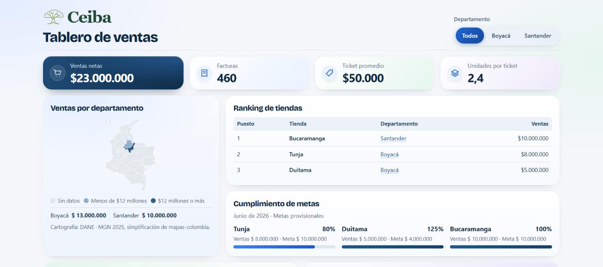
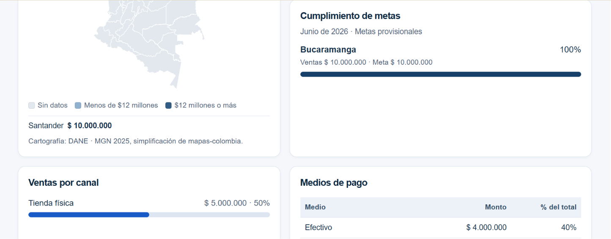
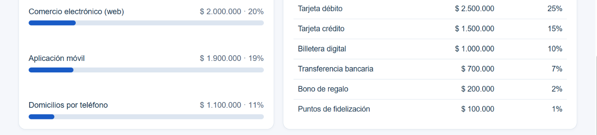

# Ceiba · Tablero de ventas

Tablero web para consultar las ventas de Ceiba, comparar tiendas y revisar el cumplimiento de sus metas. El filtro por departamento actualiza los indicadores, el mapa, el ranking, los canales, los medios de pago y las metas.

Esta versión utiliza **datos de ejemplo**. Los nombres de los canales y medios de pago se contrastaron con los catálogos del esquema `retail` en Neon. La integración con la API está pendiente.

## Vista de escritorio

![Tablero de Ceiba con el filtro por departamento, los indicadores de ventas, el mapa de Colombia y el ranking de tiendas]
<p></p>


## Cómo ejecutarlo

Desde la raíz del repositorio, con Node.js y npm instalados:

```bash
cd dashboard
npm ci
npm run dev
```

Abre la dirección que aparece en la terminal, normalmente `http://localhost:3000`.

## Qué se puede consultar

| Vista | Qué muestra |
| --- | --- |
| Ventas y ticket | Ventas netas, cantidad de facturas, ticket promedio y unidades por ticket. |
| Ranking de tiendas | Tiendas ordenadas de mayor a menor venta para el departamento seleccionado. |
| Canales y medios de pago | Ventas por canal y distribución del monto pagado por medio de pago. |
| Cumplimiento de metas | Ventas de cada tienda frente a su meta provisional de junio de 2026. |
| Mapa por departamento | Distribución geográfica de las ventas y montos de los departamentos seleccionados. |

## Prueba rápida

Selecciona **Boyacá**. Las ventas netas deben mostrar **$13.000.000** y el ranking debe incluir a Tunja en primer lugar y a Duitama en segundo. Al volver a **Todos**, el total debe cambiar a **$23.000.000** y Bucaramanga debe encabezar el ranking.

## Desarrollo y diseño

El tablero está construido con Next.js, React, JavaScript y CSS Modules. La página principal se encuentra en `app/page.js` y sus estilos en `app/page.module.css`.

- [Bitácora de desarrollo por fecha](docs/bitacora_desarrollo_ceiba.md)